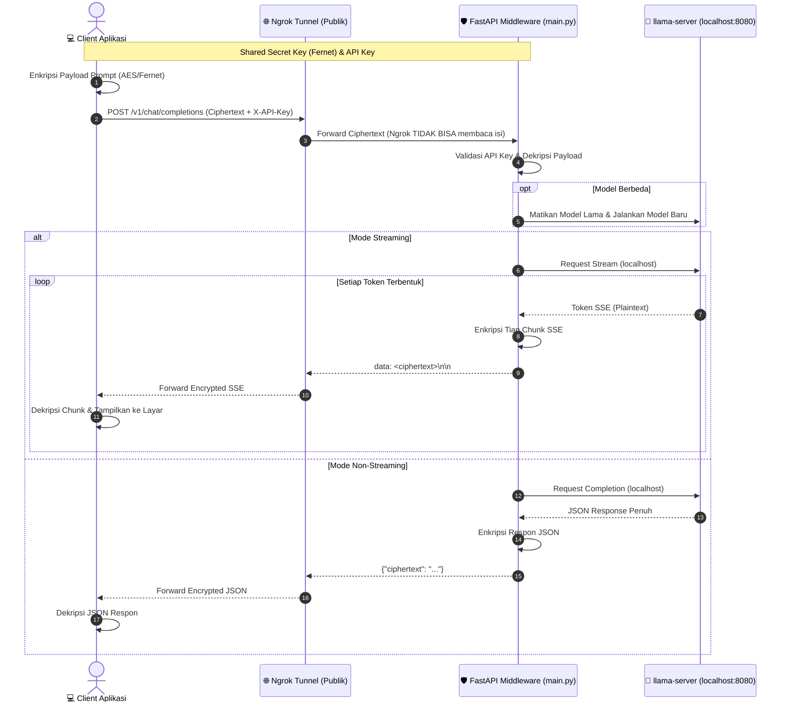

# 🛡️ Encrypted LLM API Middleware (Zero-Trust E2EE via Ngrok)

Middleware API berbasis **FastAPI** dengan arsitektur **Zero-Trust End-to-End Encryption (E2EE)** untuk layanan LLM lokal (`llama-server.exe`). 

Dirancang khusus agar aman saat diekspos ke jaringan publik melalui tunnel seperti **ngrok** tanpa risiko data prompt maupun respon terbaca oleh pihak ketiga atau server perantara.

---

## 🌟 Fitur Utama

- 🔐 **End-to-End Encryption (E2EE)**: Semua data request & response dienkripsi menggunakan algoritma simetris Fernet (AES-128-CBC + HMAC-SHA256). Ngrok dan ISP hanya melihat string acak (*ciphertext*).
- 🔑 **Autentikasi Header API Key**: Melindungi endpoint dari akses liar via header `X-API-Key`.
- ⚡ **Dukungan Streaming & Non-Streaming**:
  - **Streaming (SSE)**: Enkripsi *on-the-fly* pada setiap event/chunk token LLM secara *real-time*.
  - **Non-Streaming**: Mengembalikan seluruh respons terenkripsi dalam satu payload JSON.
- 🔄 **Peralihan Model Dinamis**: Otomatis mengganti model LLM aktif (`qwen-4b`, `qwen-9b`, `gemma-12b`) dan melepaskan VRAM proses sebelumnya.
- 🧹 **Graceful Shutdown**: Menghentikan proses `llama-server.exe` secara bersih saat middleware dimatikan.
- 📦 **Client SDK Siap Pakai**: Disertai modul [`client.py`](client.py) untuk integrasi cepat di sisi client.

---

## 🏗️ Alur Arsitektur



---

## 📁 Struktur Direktori

```text
llm-api-services/
├── .env.example                 # Template referensi konfigurasi lingkungan
├── main.py                      # Server Middleware FastAPI (Enkripsi, Routing, Streaming)
├── services.py                  # Manager siklus hidup proses llama-server (Start/Stop/Switch)
├── client.py                    # SDK Client & Test Suite untuk pengujian E2EE
├── model_config.json            # Konfigurasi perintah CLI & path model GGUF
├── requirements.txt             # Dependensi Python
└── README.md                    # Dokumentasi panduan
```

---

## 🚀 Panduan Memulai Cepat

### 1. Instalasi Dependensi
Pastikan Python 3.9+ telah terpasang:
```bash
pip install -r requirements.txt
```

### 2. Konfigurasi Kunci Keamanan
Tentukan API Key dan Secret Key yang sama antara Server dan Client.

Untuk membuat Kunci Rahasia Fernet baru, Anda dapat menjalankan perintah Python satu baris:
```bash
python -c "from cryptography.fernet import Fernet; print(Fernet.generate_key().decode())"
```

Set melalui Environment Variable atau file `.env` (disarankan):
- **Windows (Command Prompt / PowerShell)**:
  ```cmd
  set LLM_API_KEY=your-secret-api-key-here
  set LLM_SECRET_KEY=your-base64-fernet-secret-key-here=
  ```
- **Linux / macOS**:
  ```bash
  export LLM_API_KEY="your-secret-api-key-here"
  export LLM_SECRET_KEY="your-base64-fernet-secret-key-here="
  ```

---

### 3. Jalankan Server Middleware
```bash
python main.py
```
Server akan berjalan di `http://127.0.0.1:8000`.

---

### 4. Ekspos Menggunakan Ngrok / Tunnel
Buka terminal baru dan jalankan:
```bash
ngrok http 8000
```
Salin URL publik yang diberikan oleh ngrok, misalnya:
`https://your-subdomain.ngrok-free.app`

---

### 5. Mengirim Permintaan dari Client

Gunakan [`client.py`](client.py) untuk berinteraksi dengan API:

```python
from client import EncryptedLLMClient

# Inisialisasi client dengan URL ngrok / domain dan kredensial Anda
client = EncryptedLLMClient(
    base_url="https://your-subdomain.ngrok-free.app",  # Ganti dengan URL tunnel/domain Anda
    api_key="your-secret-api-key-here",
    secret_key=b"your-base64-fernet-secret-key-here="
)

# 1. Mode Non-Streaming
response = client.chat_completion(
    messages=[{"role": "user", "content": "Halo, jelaskan apa itu AI."}],
    model="qwen-4b",
    stream=False
)
print("Jawaban:", response["choices"][0]["message"]["content"])

# 2. Mode Streaming (Real-Time SSE)
token_stream = client.chat_completion(
    messages=[{"role": "user", "content": "Tuliskan 1 bait puisi senja."}],
    model="qwen-4b",
    stream=True
)
for token in token_stream:
    print(token, end="", flush=True)
```

Untuk menjalankan test suite bawaan di `client.py`:
```bash
python client.py
```

---

## 📡 Rincian Spesifikasi Endpoint

### 1. `GET /health`
Mengecek status ketersediaan middleware dan model aktif.
- **Header**: Tidak memerlukan autentikasi.
- **Response**:
  ```json
  {
    "status": "online",
    "current_model": "qwen-4b",
    "is_model_running": true
  }
  ```

### 2. `GET /v1/models`
Mendapatkan daftar model yang terdaftar dalam `model_config.json`.
- **Header**: `X-API-Key: <api_key>`
- **Response**:
  ```json
  {
    "models": ["gemma-12b", "qwen-9b", "qwen-4b"],
    "current_model": "qwen-4b"
  }
  ```

### 3. `POST /v1/chat/completions`
Endpoint inferensi utama yang menerima ciphertext.
- **Header**:
  - `X-API-Key: <api_key>`
  - `Content-Type: application/json`
- **Request Body**:
  ```json
  {
    "ciphertext": "gAAAAABl..."
  }
  ```
  *(String `ciphertext` adalah hasil enkripsi Fernet dari payload JSON OpenAI-compatible standard).*

- **Response (Non-Streaming)**:
  ```json
  {
    "ciphertext": "gAAAAABl..."
  }
  ```
  *(Didekripsi oleh client untuk menghasilkan JSON OpenAI completion standard).*

- **Response (Streaming)**:
  `Content-Type: text/event-stream`
  ```text
  data: gAAAAABl...

  data: gAAAAABl...
  ```
  *(Setiap chunk didekripsi oleh client untuk mendapatkan delta token real-time).*

---

## 🔒 Catatan Keamanan
1. **Pemisahan Kunci**: Jangan pernah membagikan atau mempublikasikan `SHARED_SECRET_KEY` ke publik (misalnya repositori git publik).
2. **Replay & Timestamp Attack**: Enkripsi Fernet secara internal telah menyertakan timestamp 64-bit dan verifikasi integritas HMAC-SHA256, sehingga ciphertext terlindungi dari modifikasi maupun pemalsuan data di tengah jalan (*tamper-proof*).
